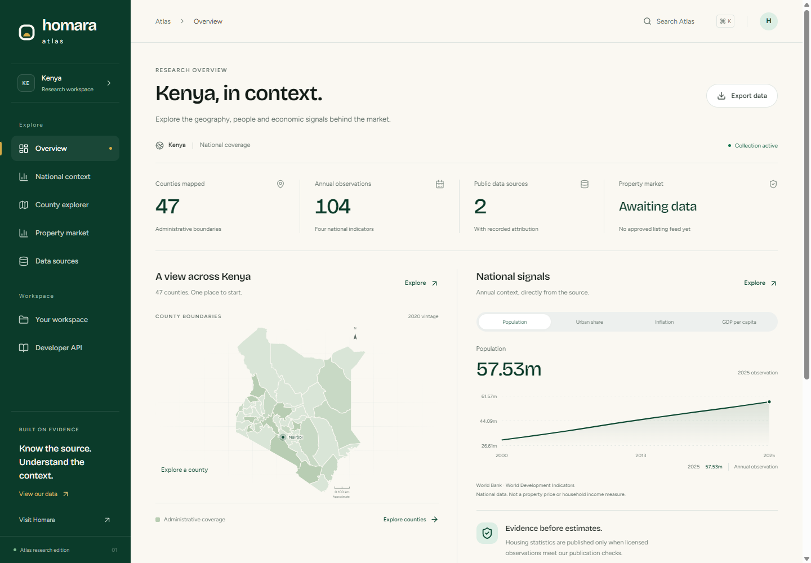
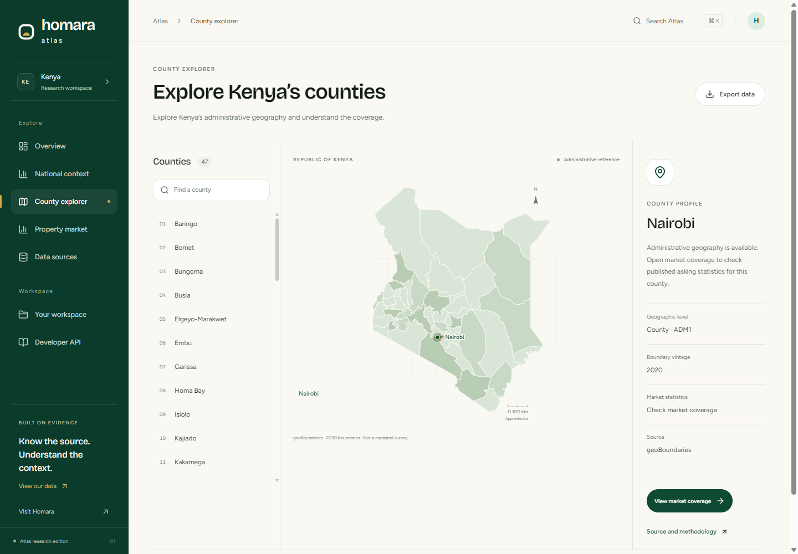
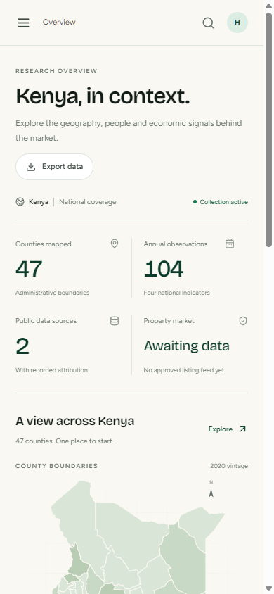
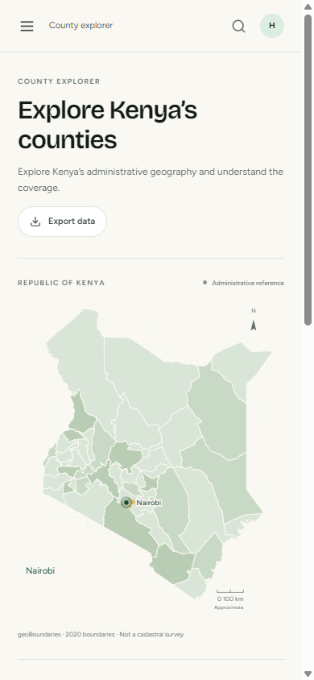
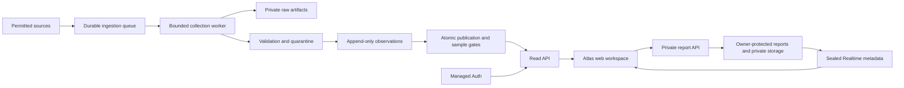

<div align="center">
  
  <h1>Homara Atlas</h1>
  <p><strong>Kenya, with context.</strong></p>
  <p>A research workspace for Kenya’s geography, national indicators<br />and property market evidence.</p>
  <p><a href="https://homara-atlas.vercel.app">Open Atlas</a> · <a href="#explore-the-atlas">Explore the product</a> · <a href="#screenshots">Screenshots</a> · <a href="#run-it-locally">Get started</a> · <a href="docs/BACKEND_API.md">API contract</a></p>
</div>



## Why Atlas exists

Property research starts with knowing what a number describes, where it came from and what it cannot tell you. Atlas brings that context into one place: explore Kenya’s counties, follow national trends, inspect the original sources and keep your research in a private workspace.

Atlas is part of [Homara](https://homara.co.ke). It is being built for people researching the Kenyan property market, analysts assembling evidence and developers who need clearly attributed data.

**The current product contains real national and geographic context. It does not yet contain an approved partner property feed.** Property estimates remain unavailable until permitted observations meet the publication checks. National indicators are not substitutes for local rents, household income or completed sales.

## Explore the Atlas

| Surface | What you can do |
| --- | --- |
| **Overview** | See dataset coverage, collection status, Kenya’s county boundaries and switchable national signals. |
| **National context** | Explore population, urbanisation, consumer price inflation and GDP per capita; choose a time range, inspect observations and export CSV. |
| **County explorer** | Search the county directory, select a boundary on the map and open a shareable county view with its geographic reference year. |
| **Property market** | Filter by county and sale/rent population. View asking statistics when evidence exists; understand why a missing or sparse estimate is withheld. |
| **Data sources** | Inspect collection dates, licences, attribution, refresh schedules and the limits of each dataset. |
| **Your workspace** | Create an account, write private reports, receive live updates, download your notes and delete reports with confirmation. |
| **Developer API** | Use the same public datasets through documented JSON endpoints and copy a working request example. |

Search pages and counties with **Ctrl/Cmd + K**. The interface supports desktop and mobile layouts, keyboard navigation, visible focus states and reduced-motion preferences. No emojis or fabricated market figures are used in the rebuilt interface.

## Screenshots

These are actual screenshots of the rebuilt application connected to the Atlas backend, captured on **5 November 2026**. They are not design mockups. Dataset totals and collection dates can change after capture.

### Desktop: county research



### Mobile: the same research, a smaller screen

<div align="center">
  
  &nbsp;&nbsp;
  
</div>

<p align="center"><em>Overview and county exploration at a 390-pixel viewport. Navigation, filters and source details adapt to touch and keyboard use.</em></p>

The visual system follows Homara’s forest green, warm cream and restrained gold palette. Original Homara logo assets, Bricolage Grotesque and Figtree establish the interface; Spline Sans Mono is reserved for code and numeric prices.

## What data is available?

Coverage verified on **5 November 2026**:

| Dataset | Recorded coverage | Source and permitted-use record | Refresh |
| --- | --- | --- | --- |
| Kenya national context | **104 annual observations**, four indicators, available years from 2000 onward | World Bank, World Development Indicators; CC BY 4.0 | Daily |
| County geography | **47 county boundaries**, reference vintage **2020** | geoBoundaries; underlying metadata identifies Public Domain sources from RCMRD/Africa GeoPortal; attribution retained | Weekly |
| Property observations | **No approved listing feed yet** | A new source must be registered and explicitly approved before ingestion/publication | Feed dependent |

The four national series are total population, urban population share, consumer price inflation and GDP per capita in current US dollars. **GDP per capita is not household income.** County boundaries are administrative context, not cadastral surveys or property coordinates.

Atlas stores source attribution, retrieval history and checksum-addressed raw artifacts. The interface distinguishes **reference year** from **collection date**, so a recent retrieval does not make an older boundary or annual observation current-year evidence.

Source documentation: [World Bank WDI](https://datacatalog.worldbank.org/search/dataset/0037712/world-development-indicators), [World Bank public licences](https://datacatalog.worldbank.org/public-licenses), [geoBoundaries Kenya ADM1 metadata](https://www.geoboundaries.org/api/current/gbOpen/KEN/ADM1/). Map-asset attribution is also recorded in [the bundled provenance file](apps/web/public/kenya-counties.provenance.json).

### How property statistics become publishable

1. Register the source, licence, permission evidence and attribution.
2. Obtain explicit ingestion approval; publication permission is a separate flag.
3. Submit or collect observations through a durable ingestion job.
4. Validate the records and quarantine failures while preserving raw provenance.
5. Publish an atomic release only from eligible evidence.

Current methodology keeps sales and monthly rents separate, uses active observations within 14 days and suppresses price estimates below **30 observations per segment**. Reviewed duplicate advertisements count as one physical property. Missing areas stay null; asking prices are not achieved transaction prices. Source revocation invalidates affected publications.

Atlas does not infer that a publicly visible property page grants permission to scrape or redistribute it. No partner consent, property inventory or sale outcomes have been invented.

## Architecture



| Layer | Current implementation |
| --- | --- |
| Web application | React 18, TypeScript, Vite, TanStack Query, Lucide and accessible Radix primitives |
| Canonical API | Hono on Neon Functions, with validated public, workspace and operator routes |
| Database | PostgreSQL 18 on Neon; checksummed migrations and separate API/worker logins |
| Authentication | Existing Neon Managed Auth integration; roles are assigned server-side |
| Files | Private object storage for raw ingestion evidence and user reports |
| Collection | Dedicated worker with scheduled execution, fenced leases, retries and durable jobs |
| Live reports | Short-lived, owner-filtered sealed Realtime queries over transactional report metadata |
| Optional compatibility API | Python/FastAPI; a restricted read-only bridge in production |

The current backend is **Neon**, not the historical Supabase/RDS/DuckDB deployment described in older repository artifacts. Legacy warehouse and Terraform files are not the canonical production pipeline. AI inference is intentionally excluded; no paid-plan upgrade is required by this implementation.

## Run it locally

### Prerequisites

- **Node.js 24** and npm.
- Access to the existing public Atlas API URLs, or your own configured backend.
- **Python 3.11** only if you need the optional Python API.
- **PostgreSQL 18** for local database contract tests; GitHub CI provisions an isolated service automatically.

### Start the web application

From the repository root:

```sh
npm ci --ignore-scripts
npm --prefix apps/web ci --ignore-scripts
```

Create `apps/web/.env.local` with the **actual public URLs** from your deployment:

```dotenv
VITE_API_URL=https://your-atlas-function-host
VITE_NEON_AUTH_URL=https://your-auth-host/neondb/auth
VITE_NEON_REALTIME_URL=wss://your-realtime-host/
```

| Browser variable | Corresponding server/provider value |
| --- | --- |
| `VITE_API_URL` | `NEON_FUNCTION_ATLAS_BASE_URL` |
| `VITE_NEON_AUTH_URL` | `NEON_AUTH_BASE_URL` |
| `VITE_NEON_REALTIME_URL` | `NEON_REALTIME_URL` |

```sh
npm run dev
```

Open **[http://127.0.0.1:5184](http://127.0.0.1:5184)**. Add the exact local origin to the API, Auth and Realtime allowlists for your backend. Without Auth configuration, public research remains available while workspace sign-in explains that it is not configured. A blank API URL uses a same-origin `/api` service; private workspace routes require the canonical authenticated API.

**Never put a database URL, owner password, storage credential, internal worker token, rate-limit secret or Realtime sealing secret into a `VITE_` variable.** Browser variables are public. Keep server credentials in ignored root env files; `.env.example` documents their names without values.

### Backend setup and operations

The live project uses the existing Neon production branch. To reproduce or administer it, follow [the backend runbook](docs/BACKEND_RUNBOOK.md), which covers migrations, dedicated credentials, source approval, operator grants, collection and recovery. Use an isolated branch or local test database for experiments.

Migrations run through `scripts/migrate.mjs` using a **direct owner connection**. Runtime functions use separate non-admin credentials. New migrations are additive and checksummed; do not edit already-applied files.

The hourly production trigger schedules due daily/weekly sources, recovers expired leases, retries eligible jobs and cleans durable report-deletion intents. Authenticated operator requests can kick the worker immediately. Registering a source does not automatically authorise its use.

## API at a glance

The canonical prefix is `/api/v1`:

| Endpoint | Access | Returns |
| --- | --- | --- |
| `GET /system/health` | Public | Process liveness |
| `GET /system/ready` | Public | Database/dedicated-role readiness |
| `GET /system/data-health` | Public | Source collection freshness |
| `GET /sources` | Public | Published sources, licences and attribution |
| `GET /geography/counties` | Public | County identifiers, names and reference vintage |
| `GET /context/indicators` | Public | Annual national observations; filter by code and paginate |
| `GET /analytics/overview` | Public | Current published market coverage |
| `GET /analytics/market` | Public | Eligible county asking-price segments |
| `/workspace/reports` | Signed-in owner | Private report creation, listing, download and deletion |
| `/admin/*` | Server-assigned operator/admin | Source registry, ingestion jobs, quality review and audit |

Public reads do not require an API key. Authentication is still required for private resources, and ordinary users cannot become operators through client-side role claims. Request budgets and bounded pagination apply. See the complete [API contract](docs/BACKEND_API.md).

## Quality and GitHub Actions

The repository keeps **six focused workflows**:

| Workflow | Why it remains |
| --- | --- |
| [Frontend CI](.github/workflows/ci-frontend.yml) | TypeScript, lint, tests, production build and high/critical dependency audit |
| [Backend/database contracts](.github/workflows/backend-database.yml) | PostgreSQL 18 migrations, repeatability, actual runtime-role permissions, jobs, publication and backend audit |
| [Python API CI](.github/workflows/ci-backend.yml) | Locked dependencies, syntax checks, formatting and compatibility API tests |
| [Secret scanning](.github/workflows/gitleaks.yml) | Prevent accidental credential commits |
| [Dependency review](.github/workflows/dependency-review.yml) | Review dependency changes for high/critical vulnerabilities |
| [CodeQL](.github/workflows/codeql-analysis.yml) | JavaScript/TypeScript and Python analysis on relevant changes and weekly |

Workflows use scoped permissions, bounded runtimes, concurrency cancellation and pinned action revisions. Source-specific CI avoids rebuilding the app for screenshot-only edits. Duplicate integration/security pipelines, obsolete AWS deployment, unused Docker publishing, legacy warehouse/Terraform validation, redundant Vercel deployment and the outdated release workflow have been removed. Vercel’s connected Git integration handles its own previews; these CI jobs do not migrate production or deploy backend credentials.

Useful local checks:

```sh
npm --prefix apps/web run type-check
npm --prefix apps/web run lint
npm --prefix apps/web test
npm --prefix apps/web run build
npm run check:functions
```

Database tests need an explicitly isolated environment. The [database workflow](.github/workflows/backend-database.yml) is an executable reference for the local PostgreSQL setup; do not aim these tests at production. Python tests run from `api` after installing `requirements.txt`.

Verification completed during this milestone: **18 backend tests**, **nine Python tests**, **three frontend environment tests**, production builds, live Auth/report/Realtime flows, actual data collection, encrypted restore and desktop/mobile browser checks. The frontend lint check retains seven existing Fast Refresh warnings in reusable primitives. Audits currently report no high/critical findings; lower-severity frontend dependency advisories remain and are not represented as resolved.

## Security, recovery and practical limits

- JWT verification, server-side roles, parameterised queries and report-owner checks protect private routes. Database RLS adds report ownership enforcement.
- API and worker credentials are non-administrative. Collection cannot approve its own source rights.
- Requests, batch sizes, strings, pagination, remote downloads, execution and storage use are bounded. Connector destinations and redirects are allowlisted.
- Reports and raw artifacts use private buckets. Download links are short-lived; failed/deleted uploads retain durable cleanup intents.
- The report live-query projection contains metadata only and is exposed through owner-filtered sealed queries; it is not a public report directory.
- Raw observations and audit evidence are append-only. Jobs retain provenance, acceptance/rejection counts and retry history.
- Encrypted Atlas backups and a restore drill are implemented. **Off-device scheduled backup retention is not configured.** Managed Auth/provider recovery is separate from the portable Atlas snapshot.
- Free-plan quotas and upstream availability remain real limits. Check source freshness independently of API liveness. The legacy generic offline worker is retired so private responses are not stored in its old cache.
- A full-history scan identified an old Upstash Redis credential in a previous commit. It is not used by the current backend, but revocation has not been verified. See [the historical credential note](docs/SECURITY_NOTES.md).

These controls and tests are implementation evidence, not a guarantee of unlimited capacity, zero future defects or an independent penetration test.

## Repository guide

```text
apps/web/src/atlas/       Current product pages, charts, map and navigation
apps/web/public/brand/   Original Homara brand assets
functions/backend/      Canonical API, worker, validation and publication
database/neon/          Ordered, checksummed database migrations
backend-tests/          Runtime-role, ingestion and publication contracts
scripts/                Migrations, provisioning, operator tools and recovery
api/                    Optional Python compatibility API and tests
docs/screenshots/        Real desktop and mobile product captures
docs/                   API, operations, evidence and implementation handoffs
```

Retired frontend source files remain outside the active routes. Older infrastructure/demo folders are retained as historical artifacts; they should not be mistaken for the live deployment or used to ingest synthetic production data.

## Further reading

- [Backend operations and recovery](docs/BACKEND_RUNBOOK.md)
- [Backend API contract](docs/BACKEND_API.md)
- [Backend verification evidence](docs/BACKEND_VERIFICATION.md)
- [Frontend design and browser verification](docs/FRONTEND_REFRESH.md)
- [Data-platform review](docs/ATLAS_DATA_PLATFORM_REVIEW.md)

When refreshing the screenshots, use the real backend, wait for data/fonts to load, capture both desktop and mobile layouts and update the capture date. Never include a real user’s email, private notes, credentials or test-market fixtures in a published image.
