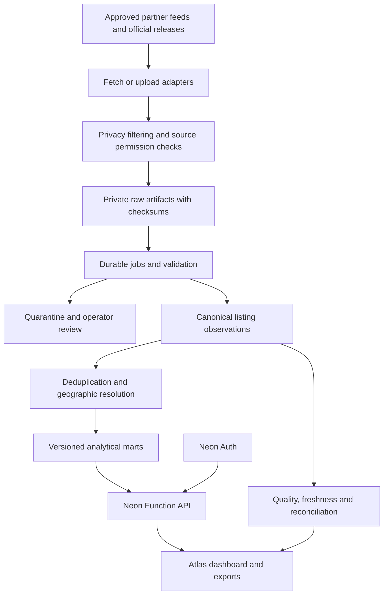

# Atlas data platform review and implementation blueprint

Review date: 5 November 2026 (Africa/Nairobi).

Scope: inspected the current local Neon integration, importer, database migration, Function API, Python API, dbt models/seeds, warehouse SQL, event contract, data CI, and architecture documentation. Checked current primary sources for Kenyan housing data, reuse restrictions, geographic data, and hosting limits. This is a design review; it does not apply migrations, collect third-party data, or change the deployed application. Existing uncommitted work is preserved.

## Executive assessment

Atlas now has a functioning application foundation, but it does not yet have a dependable market-data production system. Passing application tests proves connectivity and application behavior, not the validity, representativeness, or freshness of market statistics.

The next investment should be the data pipeline and its evidence, before additional dashboard features. Keep AI excluded and stay within the user's free-plan constraint. Start with explicitly defined pilot markets and residential segments instead of implying coverage of all Kenya.

Recommended pilot product: current asking rents and sale asking prices, separated by location, property type, and bedroom count; deduplicated inventory; freshness and coverage; and comparable listings. Add historical changes only after observations accumulate. Completed-transaction prices, occupancy, realized yields, valuations, and affordability require additional evidence.

## 1. Concrete findings in this repository

| Priority | Finding | Consequence / required correction |
| --- | --- | --- |
| P0 | `database/neon/001_atlas.sql` has one row per `listing_id`; the importer updates it in place. | Historical prices and listing states disappear. Introduce append-only observations and a separate current-state projection before routine ingestion. |
| P0 | IDs are not namespaced by source. | Two providers can both send listing `123`. Use a unique `(source_id, source_listing_id)` key. Cross-source matching belongs in a separate entity-resolution layer. |
| P0 | No sale/rent/short-stay listing type, rent period, original currency, listing status, or source URL exists. | Metrics can mix incompatible records. Preserve these attributes and filter every statistic to a declared segment. |
| P0 | The importer requires both sale price and rent on every row, while the SQL allows rent to be null. | Real rental-only or sale-only feeds cannot be represented correctly. Missing values must remain null; do not encourage zero or invented counterpart values. |
| P0 | The importer trusts a free-text source and merely rejects certain words. | Source validation is structural, not evidence of permission or authenticity. Add an approved source registry, ingestion provenance, and review state. |
| P0 | The API averages all records without an active-status or reporting-period filter. | Withdrawn/stale listings can influence statistics indefinitely. Define active inventory, as-of dates, and freshness cutoffs. |
| P1 | `data-platform/ingestion/lambda_function.py` fetches JSONPlaceholder posts. | This is demonstration code, not a Kenyan property connector. Remove it from production workflows or clearly isolate it as a fixture. |
| P1 | Python ingestion generates synthetic data; `/ingestion/jobs` returns a Supabase placeholder. | There is no durable production ingestion control plane. Add job records, checkpoints, retries, and reconciliation. |
| P1 | dbt stages `atlas_raw.kenya_listings`, but the deployed Function reads the public staging table directly. | The transformations and production API do not share a proven pipeline. Select a canonical path and test it end to end. |
| P1 | Warehouse SQL uses Redshift-specific `SORTKEY`, `DISTKEY`, `GETDATE`, and identity syntax; dbt contains Redshift-oriented grants/config. | These files are not a ready PostgreSQL warehouse migration. Port deliberately; do not apply wholesale. |
| P1 | The dbt price model uses raw average-price ratios and assumes a 2020 base; comments alternate between January and the whole year. | Composition changes can appear as price growth, and absent base data yields nulls. Define an attainable base and label the methodology accurately. |
| P1 | `lag(..., 12)` counts observations, not calendar months. | Missing periods can produce false year-on-year comparisons. Use a calendar spine and exact period joins. |
| P1 | Affordability seeds contain estimated incomes and even city labels such as Eldoret/Thika in a county column. Fixed assumptions include 13% interest, 360 months, and a 28% payment ratio. | Geography and financial assumptions are not defensible household affordability evidence. Keep unpublished until the source, geography, period, and scenario definitions are explicit. |
| P1 | Health is a constant success response; error logging records only an error name. | Neither dependencies nor data freshness are monitored. Separate liveness, dependency readiness, and data health. |
| P1 | Existing tests largely cover app connectivity, validation, and synthetic extraction. Data CI compiles models and suppresses some lint errors. | Add golden-data tests, replay/idempotency tests, reconciliation, and metric correctness checks. Compilation alone does not prove valid analytics. |
| P2 | Architecture documents describe operational Supabase, Kafka/MSK, S3, Redshift, and conflicting backend languages. | Publish one current architecture and mark legacy designs clearly. Avoid deploying multiple overlapping platforms during the pilot. |

P0 means required before regular real-data imports/public analytical claims. P1 means required before opening a dependable public beta. These are proposed priorities, not externally imposed standards.

## 2. Data acquisition strategy

### Acquisition order

1. **Consented/contracted partner feeds:** agents, developers, and property managers supply CSV/JSON/SFTP/API exports, initially manually uploaded. Capture availability, price changes, and whether a reported outcome is confirmed or merely asserted.
2. **Approved Homara first-party data:** only after an explicit product/data-governance decision. Export an allowlisted analytical contract; do not connect Atlas indiscriminately to operational tables. Keep customer identities, contact details, messages, and applications out of the market warehouse. Existing repository statements excluding operational data must be reconciled before this expansion.
3. **Official aggregate series:** KNBS housing/census publications and CBK/KBA market reports provide contextual benchmarks. They do not supply live listing inventory or automatically establish neighbourhood-level rent/income estimates.
4. **Licensed geographic context:** administrative areas, a curated neighbourhood gazetteer, roads, amenities, and appropriately licensed boundaries. Record source vintage and positional accuracy.
5. **Other property portals:** pursue written permission or a licensed feed. Do not build the business around assumed scraping access.

### Candidate source register

All external sources below are candidates; being listed here does not approve ingestion or imply that an API, commercial licence, or partnership exists.

| Source | Useful contribution | Acquisition / limitation |
| --- | --- | --- |
| Homara / partners | Listing attributes, timestamps, price changes, explicit availability and verified outcomes | An approved feed or export; define reuse rights, retention, permitted publication and deletion obligations first. |
| KNBS RPPI | Official aggregate residential price context | Published report/table extraction after licence review. The checked April 2026 publication states CC BY-NC 4.0, so do not assume commercial reuse is permitted. [Publication](https://www.knbs.or.ke/wp-content/uploads/2026/05/Kenya-Residential-Proprety-Price-Index-2026.pdf), [series page](https://www.knbs.or.ke/residential-property-price-index-rppi/). |
| KNBS census / housing survey | Tenure, housing conditions, household and demographic context | Use the actual geographical resolution and survey reference period. A census or survey is not a current individual household-income feed. Review each release's permissions. [Census](https://www.knbs.or.ke/reports/kenya-census-2019/), [2023/24 housing survey](https://repository.knbs.or.ke/entities/publication/d8d145a4-b3c7-403d-ae11-c32c07f2ea27). |
| Central Bank of Kenya | Mortgage-market context and published financing statistics | Periodic reports; distinguish historical survey results from a current loan quote. [Reports](https://www.centralbank.go.ke/reports/bank-supervision-and-banking-sector-reports/). |
| Kenya Bankers Association | A methodological/market benchmark | KBA describes a quarterly hedonic index. Store it as a separate external series, not an Atlas result; obtain necessary republication rights. [HPI](https://www.kba.co.ke/housing-price-index/). |
| OpenStreetMap | Roads and amenities for geographic context | ODbL and attribution obligations apply. Data licensing does not grant unrestricted use of public tiles/geocoding infrastructure. [Licence](https://www.openstreetmap.org/copyright), [service policies](https://operations.osmfoundation.org/policies/). |
| BuyRentKenya and other portals | Potential listing feed/partnership | BuyRentKenya's current terms prohibit scraping/data-mining for reuse without written consent. Other providers need their own review; permission from one provider does not cover another. [Terms](https://www.buyrentkenya.com/legal). |
| Lands/Ardhisasa services | Specific authorized ownership/encumbrance due diligence | Official land search is a defined service, not evidence of an open bulk transaction-price API. Keep out of general inventory ingestion until a lawful access arrangement exists. [Lands search service](https://lands.go.ke/issuance-search-certificate). |

For every source, store owner/contact, source URL, acquisition method, permission/licence reference, permitted fields and uses, attribution text, personal-data status, refresh expectation, expected geography, retention, deletion process, parser version, and approval status. Stop publishing affected derived outputs when rights expire; retain/reprocess/delete underlying material according to its permission terms.

### First practical acquisition deliverable

Prepare one partner template and a signed-off source record. Pilot one clearly labelled market segment in a small number of neighbourhoods. Do not promise national coverage. Agree how partners communicate price revisions, removed listings, and confirmed outcomes. Scheduled exports are sufficient initially; an API is not a prerequisite for good data.

## 3. Target architecture

Use the existing React/Vite frontend, Neon Auth, PostgreSQL, private object storage, and Function API. Keep Python as the collection/normalization/analytical worker where its libraries are useful. Python can initially run as an explicitly scheduled CI or operator job, with durable state in PostgreSQL. Use a single scheduler per connector. Revalidate scheduler/hosting terms before choosing it for commercial production.

Do not make the browser run collection jobs. Do not rely on an in-process background task to survive a restart. Realtime is useful for job/report status; aggregate market statistics can refresh when a new data release is published.

Choose one metric implementation. My recommendation: SQL transformations/materialized results define metrics, the Function serves them, and Python prepares data. Retire duplicated analytical calculations in the optional FastAPI path after compatibility needs are assessed. dbt can orchestrate/version these SQL models once ported to the actual PostgreSQL schema; do not maintain unused dbt logic alongside independent production formulas.

Kafka, MSK, Redshift, Spark, a separate search cluster, and AI are unnecessary for this pilot. Add infrastructure in response to measured workload and reliability requirements.

## 4. Database design

Use one PostgreSQL database initially with clear schemas and roles. Proposed logical separation: `control` for sources/jobs, `raw_meta` for artifact manifests, `core` for canonical entities/observations, `mart` for published metrics, and `app` for user-owned features. Preserve provider-managed Auth tables.

| Entity | Grain / purpose |
| --- | --- |
| `sources` / `source_agreements` | One provider and versioned permission/licence records. |
| `ingestion_runs` | One connector execution: run ID, source, window, cursor, parser version, counts, timestamps, status, error category and lease. |
| `ingestion_items` / `raw_artifacts` | One source item/artifact and its checksum, private object key, response metadata, ingestion run and replay status. Avoid repeating large payloads in PostgreSQL. |
| `locations` / `location_aliases` | Stable geographic IDs, county/subcounty/ward relationships, neighbourhood aliases, polygon version and source. Neighbourhoods need not be official administrative areas. |
| `property_entities` | A physical unit/parcel/building at a declared level, where evidence permits a match. Unknown identity is allowed. |
| `source_listings` | One advertisement identified by `(source_id, source_listing_id)`, with links to a property entity only when justified. |
| `listing_observations` | An append-only observation of one advertisement at a time, with provenance and normalized attributes. |
| `listing_presence` / `listing_events` | Successful sightings and explicit state changes, including withdrawn/unknown outcomes. |
| `entity_matches` | Matching evidence, confidence, rule/model version, review state, and reversible merge history. |
| `quality_issues` | Record/run-level findings and their review/resolution history. |
| `external_series` / `external_observations` | Official index or economic observations by series, geography, reference period and release vintage. Keep revisions. |
| `metric_definitions` / `metric_releases` | Formula/filter versions, input cutoff, source set, publication timestamp and lineage. |
| `market_snapshots` | Segment/location/period statistics with sample counts, freshness, coverage, methodology and release ID. |
| `reports`, `watchlists`, `saved_searches`, `audit_events` | User-owned application features, isolated from public analytical facts. |

### Observation fields that must exist

- Identity: observation ID, source ID, source listing ID, source URL, optional canonical property ID, artifact ID and ingestion run ID.
- Time: `observed_at`, source's own `updated_at` when supplied, first/last seen, effective date if known, ingested time. Never invent source timestamps from fetch time.
- Classification: sale, long-term rent, short stay, or other; residential/land/commercial; property subtype; bedrooms/bathrooms when available; furnished state and new-build status when relevant.
- Money: original amount/currency, normalized amount, price basis, rent frequency, service charge/deposit and inclusion flags. Store exchange-rate source/date only when converting.
- Area: original value/unit, normalized square metres, separate plot and floor areas. Unknown size remains null. Land is not comparable to apartment floor area.
- Geography: stable location IDs, raw location text, geocode method/source, precision and confidence. Do not present a neighbourhood centroid as an exact property location.
- State/quality: active/withdrawn/let/sold/unknown, reason and evidence; record validity, provenance tier, match confidence and human-review status.

Allow genuine rental-only and sale-only observations. Zero bedrooms can mean a studio/bedsitter; missing is different. A removed advertisement is not proof of a completed sale or letting. One building can contain multiple similar units; deduplication must respect that.

### Storage and query rules

Use numeric money fields, explicit currency and time zones, source-scoped keys, foreign keys, allowed-value checks, and uniqueness on replay identities. Index source listing/time, property/time and observed geographic segment/time; add spatial indexing when geometry is introduced and extension support is verified. Do not partition prematurely; measure table size and query plans first.

Keep recent current-state projections small. Archive approved raw artifacts and older observations according to their retention policy, retaining enough lineage to reproduce each published release. Deduplicate unchanged raw payloads by hash while preserving sighting metadata; repeated identical advertisements must not become additional inventory counts.

Runtime API roles should read marts and write only the application data they require. Workers write approved ingestion/core tables. A separate migration role owns DDL. Do not run every request with the project-owner credential. Application authorization and database grants are complementary; revoking PUBLIC alone is not a complete role design.

## 5. Reliable ingestion lifecycle

1. Confirm an active source agreement and compatible schema version.
2. Create a durable run with an idempotency key, watermark, and expiring worker lease.
3. Fetch within provider limits using conditional requests/checkpoints where supported. Record partial pages and completeness.
4. Strip unneeded personal data before durable storage. Store only permitted raw material privately, with a content hash.
5. Parse into staging; preserve original units and source values alongside normalized values.
6. Validate record shape, domain rules, geography, timestamps, plausible segment-specific bounds, and missingness. Quarantine failures with clear reasons.
7. Resolve location aliases and source-specific identities. Propose cross-source duplicates; review uncertain matches.
8. Append valid observations atomically. Advance the cursor only after the corresponding work is committed. Use an outbox or reconciliation process where database and object-storage writes cannot be atomic.
9. Rebuild affected aggregates; execute quality gates. Publish a new release atomically only if it passes.
10. Close the run with fetched/parsed/accepted/quarantined/duplicate/published counts and last successful cutoff.

Retries need bounded exponential backoff, timeouts, terminal-vs-transient classification, and a dead-letter/review queue. Prevent concurrent workers from processing the same lease. A crash, partial source outage, expired permission, or parser break must not replace a healthy market snapshot with an apparent zero market.

Define disappearance separately from source outages. Require successful sufficiently complete source observations before inferring inactivity. Use source-specific missed-sighting thresholds, not one universal rule. Preserve explicit partner statuses as stronger evidence than an advertisement disappearing.

## 6. Analytics contract

Every response/export should identify reference period, published time, input cutoff, geography, segment filters, methodology version, observation count, unique-listing/property count where supported, source coverage and quality status.

| Metric | Defensible initial definition / boundary |
| --- | --- |
| Asking rent | Median and quartiles for active, deduplicated long-term rental listings in the same bedroom/type/geographic segment; normalize rent period and disclose fee inclusions. |
| Asking sale price | Same segment discipline for sale advertisements. This is not achieved transaction value. |
| Price per square metre | Use only comparable, valid floor areas; publish contributing area-data count separately. Do not divide floor prices by plot sizes. |
| Available inventory | Unique active advertisements, plus a separate canonical-property count when matching supports it. Do not silently switch units of count. |
| Price reductions | Compare comparable observations for the same advertisement/entity; separate relisting from a price change. |
| Days observed on market | Derived from successful observations and explicit state changes; disclose left-censoring and breaks. Do not call it actual transaction time. |
| Trends | Compare identical segments over calendar periods and show composition/source changes. Missing months remain missing. |
| Gross asking yield | Only a justified matching/segment methodology; ratio of unrelated sale/rent averages is not realized property yield. Exclude from the initial launch if evidence is insufficient. |
| Net yield | Requires actual vacancy, expenses and achieved rents; absent from initial launch. |
| Affordability | First offer an explicitly parameterized scenario calculator. A household affordability index needs defensible income distributions and compatible location/period data. |
| Price index | Start with labelled median asking-price trends. A quality-adjusted or repeat-sales index needs sufficient suitable history, an explicit base and validated methodology. KBA's hedonic method is a benchmark, not permission to label Atlas's raw averages equivalent. |

Asking prices and transaction prices describe different stages and can differ materially; this distinction is supported by the [IMF-hosted residential property price handbook](https://www.elibrary.imf.org/display/book/9789279259845/ch009.xml). Labels must follow the underlying evidence.

Use a publication rule for sparse cells. As an initial configurable pilot rule, consider suppressing or marking cells below 30 effective independent listings; this number is a design proposal, not a guarantee of statistical validity or a universal standard. Also inspect source/agent/building concentration and effective sample size. A thousand duplicates do not make a representative sample. Never turn missing observations into zero prices or zero demand.

## 7. Backend and operational requirements

- Keep generic market endpoints public only for publishable aggregates. Authenticate operator imports and user-owned resources. Define viewer, analyst, data-operator, and administrator capabilities explicitly.
- Validate filters centrally: geography IDs, listing type, bedroom range, dates, and bounded page size. Add consistent response envelopes, pagination, API versions, and OpenAPI contracts.
- Rate-limit public endpoints and costly exports; cap report count/size per user and total retained artifacts. CORS is not authentication or resource-abuse protection.
- Apply query/statement timeouts and small connection pools; compute aggregates on ingestion/publication rather than scanning all observations on each dashboard request. Cache by metric release and filters.
- Distinguish `live` (process), `ready` (dependencies/migrations), and `data-health` (freshness/coverage/pipeline) endpoints. Preserve structured request/run IDs, useful sanitized errors, and operational alerts.
- Persist import progress and checkpoints. Provide operator views for source freshness, failed jobs, schema drift, quarantined records, duplicate review, approved releases, and rollback.
- Keep private reports out of shared caches. Enforce ownership on every read/write/download path; test account changes and expired sessions.
- Preserve report/export provenance and generated time. Use short-lived download links and an explicit retention/deletion lifecycle.
- Back up database state and permitted objects to an independently recoverable location. Document recovery objectives and perform a restore test. A branch or short restore window is not the entire backup strategy.

## 8. Privacy, rights, and geographic data

Atlas should normally publish aggregated property-market facts, not landlord/tenant identity data. Do not ingest phone numbers, national IDs, PINs, emails, chat bodies, applications, or unrelated account fields into market datasets. Even a public listing may contain personal information; public visibility alone does not establish every reuse right.

The current project's US region makes the cross-border handling of any personal data, including Auth/user-owned records, a design consideration. Review the lawful processing/transfer conditions, processor arrangements, retention, access/correction/deletion process, and any applicable registration obligations with appropriate Kenyan legal review before expanding collection. Do not treat removing a name as proof of anonymization. Primary references: [Data Protection Act](https://kenyalaw.org/kl/fileadmin/pdfdownloads/Acts/2019/TheDataProtectionAct__No24of2019.pdf), [General Regulations](https://new.kenyalaw.org/akn/ke/act/ln/2021/263/eng%402022-01-14/source).

For maps, curate stable location aliases first. Use authorized boundary datasets and record their vintage; informal neighbourhood extents need a declared definition. Evaluate PostGIS against the actual deployed PostgreSQL/extension versions before adopting it. No need to geocode every advertisement precisely to ship a useful neighbourhood pilot.

Do not use public Nominatim as a bulk pipeline or autocomplete backend. Its policy has a maximum of one request per second, additional restrictions for long-running/regular bulk tasks, caching/identification requirements, and prohibits autocomplete. Prefer a curated gazetteer, licensed extracts, or a provider arrangement appropriate to the workload. [Nominatim policy](https://openstreetmap.github.io/owg-website/policies/nominatim/).

## 9. Free-plan operating envelope

The current published Neon Free page lists 100 CU-hours monthly per project, 1 GB database storage and 5 GB Object Storage, with Auth, Functions and beta Realtime. These are public listed limits checked on the review date, not proof that a particular account's effective entitlements match; verify the account dashboard before setting budgets. [Pricing](https://neon.com/pricing).

Use a measured pilot: daily batch collection rather than continuous polling where the feed allows it, compact normalized rows, deduplicated compressed artifacts, bounded retention, precomputed summaries and capped exports. Track actual table/index/WAL/artifact sizes and compute/transfer consumption. Define warning thresholds and a stop/skip policy before quotas are reached. Do not promise perpetual nationwide ingestion under a free plan.

Realtime should update user reports/jobs while pages are open, not keep every market feed continuously subscribed. Add no AI workload. Avoid storing photographs unless rights and product needs justify them; image storage can overwhelm a pilot's budget much faster than normalized listing data.

## 10. Implementation order and acceptance gates

### Phase A: data foundation

- Agree initial audience, exact geography and sale/rent segments.
- Approve the first source and its licence/partner export contract.
- Add source/run/artifact/location/source-listing/observation tables with append-only history.
- Version the canonical data contract and null/unit/status rules.
- Add replayable ingestion, idempotency, quarantine and explicit completeness tracking.

Acceptance: reimporting an identical feed changes no counts; overlapping provider IDs remain distinct; a changed price preserves the old observation; incomplete/failed runs do not infer mass withdrawals; every published record has lineage to an approved source.

### Phase B: trustworthy analytics

- Port the selected SQL transformations to PostgreSQL and the actual schema.
- Add calendar-aware, segment-specific medians/quartiles and current inventory.
- Publish source coverage, age, sample size and quality badges.
- Add a small operator review interface and benchmark against independently reviewed fixtures.

Acceptance: rental-only/sale-only feeds work; zero/missing distinctions survive; duplicated advertisements do not inflate inventory; missing periods do not become false MoM/YoY figures; published releases can be reproduced and rolled back.

### Phase C: dependable public beta

- Add role separation, endpoint/resource quotas, operational monitoring and restore drills.
- Add contracts/integration tests for the full source-to-dashboard path, migration checks on an isolated branch, and scheduled freshness checks.
- Configure the chosen production origin, verify deployed browser flows, and run hosted CI on a reviewable branch.

Acceptance: a failed connector alerts operators and leaves the prior valid snapshot published; cross-user access is denied; a restored environment reproduces a known report; deployment and data failures are distinguishable.

### Later, only when data supports them

Historical indices, achieved-price datasets, scenario affordability, net-yield analysis, coordinates/heatmaps, alerts/watchlists, partner APIs, and broader geographic coverage. No unsupported safety scores, investment rankings, forecasts, or title-verification claims.

## Recommended immediate next milestone

Build the source registry, durable ingestion runs, source-scoped listing identity and append-only observation migration, then connect one approved partner export. Those changes unblock a defensible pilot; more dashboard cards do not.

Before collecting data, resolve three product decisions: who supplies the first permitted feed; which exact local markets/property segments are covered; and whether approved Homara first-party data is in scope. None should be silently inferred from the presence of an integration file.
